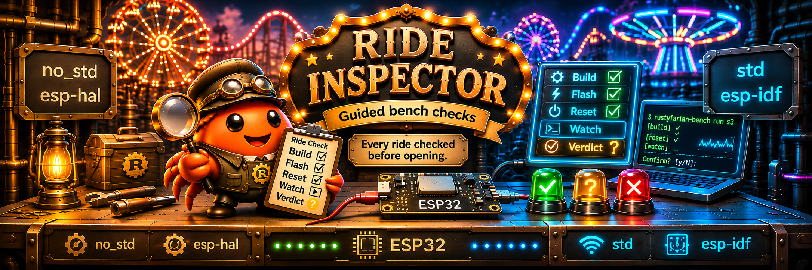
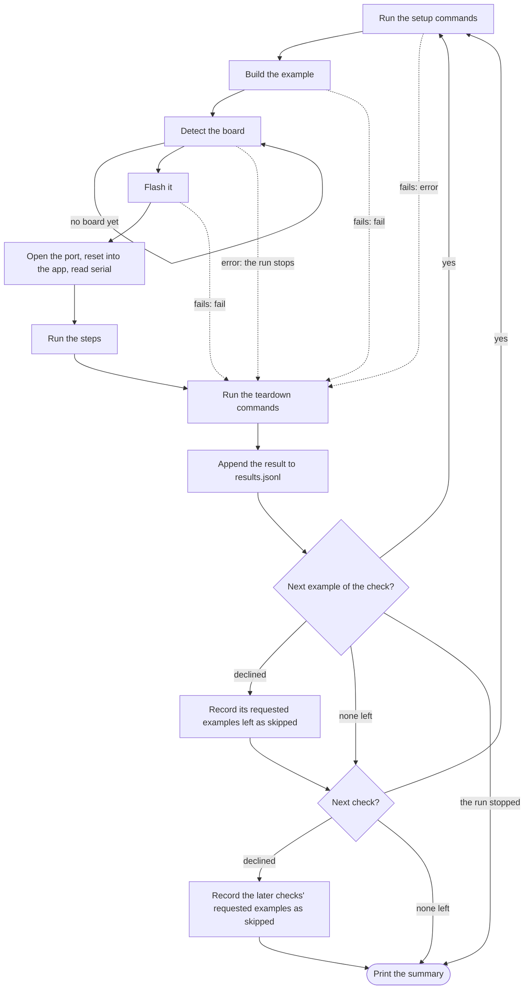
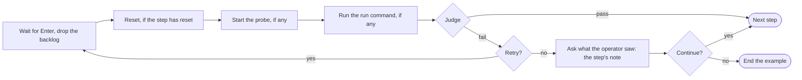
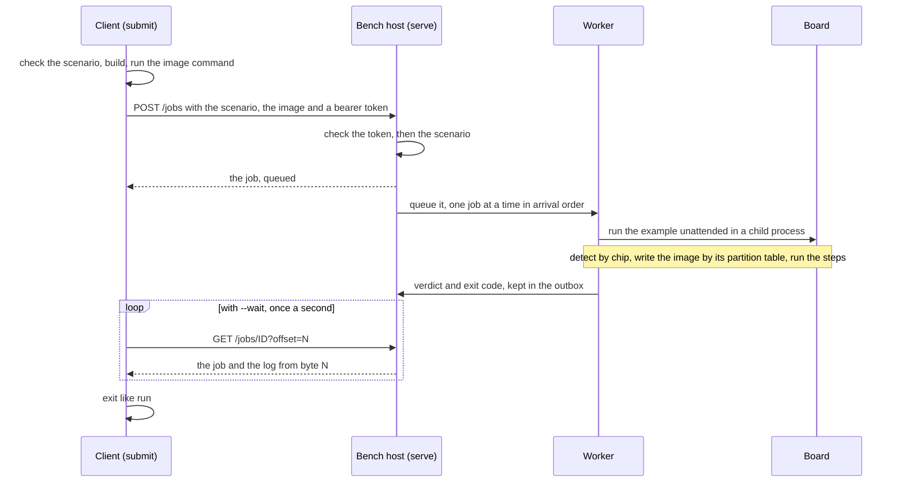
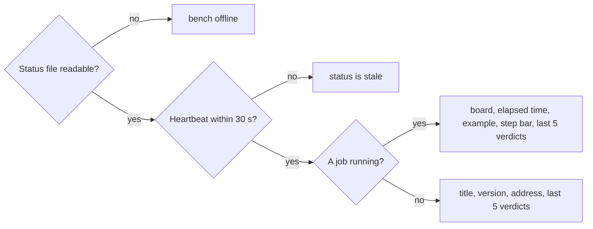

# Rustyfarian (remote) Bench

<p align="center">
  
</p>

[](https://github.com/datenkollektiv/rustyfarian-bench/actions/workflows/verify.yml)
[](https://github.com/datenkollektiv/rustyfarian-bench/tags)
[](LICENSE-MIT)
[](pyproject.toml)
[](https://github.com/astral-sh/uv)
[](https://github.com/astral-sh/ruff)
[](https://mypy.readthedocs.io/)

Guided, rerunnable hardware bench tests for the rustyfarian ESP32 crates.
A consumer repo describes its boards and checks as TOML under `bench/`.
The runner builds the example, waits for the right board, flashes and resets it, captures the serial output, and walks the operator through each step with an automatic verdict.

## Getting started

- Needs [`just`](https://github.com/casey/just), [`uv`](https://docs.astral.sh/uv/), [`espflash`](https://github.com/esp-rs/espflash) and the consumer's Rust toolchain.
- Python ≥ 3.12 is enough; `uvx` provisions it if missing.
- Hardware runs are tested on macOS only; Linux serial ports are detected but untested on a bench, and Windows is unsupported.

A consumer runs a pinned release without a checkout; bumping the tag in its `bench` recipe opts into a new release:

```bash
uvx --from git+https://github.com/datenkollektiv/rustyfarian-bench@v0.7.0 rustyfarian-bench --repo . list
uvx --from git+https://github.com/datenkollektiv/rustyfarian-bench@v0.7.0 rustyfarian-bench --repo . run s3
```

## Usage

```bash
# from a consumer repo (e.g. rustyfarian-peripherals)
just bench hal_s3_b3f              # one example, then offers the scenario's next examples
just bench hal_s3_b3f --no-twins   # only the named example, not its twins
just bench s3/rotary               # one check on one board
just bench s3                      # every check for a board

# from this repo, against a sibling checkout: <repo> <target> [flags]
just bench rustyfarian-peripherals s3 b3f
just bench-list rustyfarian-ws2812

# directly
uv run --project ../rustyfarian-bench rustyfarian-bench --repo . run hal_s3_b3f
uv run --project ../rustyfarian-bench rustyfarian-bench --repo . list
uv run --project ../rustyfarian-bench rustyfarian-bench detect
```

## Session flow

Each example runs through these stages; a failed stage jumps to the teardown, so every example leaves a recorded result.



- The build (`commands.build`, or the board's own `build`) comes before detection, so the slow part is done before the board is needed.
- The flash (`commands.flash`, or the board's own `flash`) gets the detected `{port}`.
- The next example is often a twin, e.g. the `idf` one; a declined example you asked for is `skipped`, declined twins of a named example record nothing.
- The runner never uses `espflash monitor` (without a TTY it leaves a USB-JTAG chip in the flash stub).
- It never uses `espflash reset` either: that enters the bootloader first and leaves a native-USB S3 in download mode.

### Detecting the board

- The bench polls the serial ports and runs `espflash board-info` on each until the board's chip (and optional MAC) answers.
- A port another session holds is skipped, so two boards can bench side by side.
- Pin `mac` in `bench/bench.local.toml` when two boards share a chip: the lock is only held while a session reads its port.
- `run --detect-timeout SECONDS` ends the wait with an `error`; without it, the run waits for a plug-in.
- No `board-info` starts after the limit, though a running one may overrun it.
- `run --unique-board` refuses to guess: two boards of the chip, with no pinned `mac` or `--port`, end the run with an `error` naming both ports.
- Under `--unique-board`, a busy or silent port blocks the decision until it resolves or `--detect-timeout` ends it.

A board with `detect = false` (e.g. an AVR, which espflash cannot identify) never runs espflash.
It is found by `usb_id = "vid:pid"`, plus `usb_serial` to tell two identical bridges apart.
Without them it needs `--port`, and the run stops without it: a lone attached port is no proof of which board it is.

### Reading serial

- The port is opened exclusively and read with pyserial, which reopens it across USB re-enumeration.
- The open clears RTS before DTR, so it does not itself reset an ESP (USB Serial/JTAG or the usual RTS/DTR auto-reset circuit).
- Every line is echoed and written to `bench/<board>/logs/<example>-<stamp>.log`; `baud` is per board.

| Board `reset`     | Pulse                                                      |
|:------------------|:-----------------------------------------------------------|
| `"rts"` (default) | RTS, esptool's USB-JTAG sequence                           |
| `"dtr"`           | DTR, for auto-reset bridges (Arduino Nano, CH340/FT232)    |
| `"none"`          | no pulse, but the ESP-safe open stays                      |

- On a `"dtr"` board the reader raises DTR only for its pulse, though the OS or driver may still toggle the lines while opening.
- Under `"none"`, the open's brief DTR high can still reset a DTR auto-reset board; use `"dtr"` for those.

### Running the steps



- The step's clock starts after the Enter, once the operator has read the instruction.
- `arm = false` skips the Enter and keeps the backlog, for a step that must read what the reset printed (e.g. the banner).
- Timed waits show a shrinking countdown on a terminal.
- An armed `duration` step's prompt shows its length: Enter keeps it, a typed number of seconds changes it for this run.
- A longer length asks for confirmation; a changed one adds `(scenario: N s)` to the step detail.
- An `attended` watch (a `duration` step with `attended = true`) ends early and passes on Enter, with the detail `ended by operator after N s of M s`.
- A `reject` seen before that Enter still fails it.

### Unattended and attended runs

- `--unattended` runs only the steps that need no person (no `confirm`, no `attended = true`) and implies `--yes`.
- `--attended` runs only the steps that need one.
- A scenario with no step for the mode is not built, flashed or recorded; a run with nothing left fails.
- Each result records its `mode` (`"unattended"`, `"attended"` or `null`), so a pass in one mode is never read as a full pass.
- To wrap up a release, run `just bench <board> --unattended` and walk away, then `--attended`; the release needs both to pass.

## Consumer layout

```
bench/
├── bench.toml        commands + boards
├── bench.local.toml  optional, git-ignored: per-machine board values
└── s3/
    ├── b3f.toml      one scenario
    ├── logs/         captured output
    └── results.jsonl one JSON line per example run
```

`bench/bench.toml`:

```toml
[commands]
build = ["just", "build-example", "{example}"]
flash = ["just", "flash", "{example}", "{port}"]
image = ["just", "save-image", "{example}", "{image}"]   # optional: only `submit` runs it

[boards.s3]
chip = "esp32s3"
name = "CrowPanel 1.28\" HMI (ESP32-S3)"
# mac = "dc:54:75:aa:bb:cc"   # pin one physical board: put it in bench.local.toml, see below
# checks = ["pulse", "rainbow"]   # run these first, in this order; the rest follow by name

[boards.avr]
chip = "atmega328p"
name = "Arduino Nano"
detect = false                                  # espflash cannot identify it
usb_id = "0403:6001"                            # found by USB identity instead (FTDI FT232R)
reset = "dtr"                                    # auto-reset bridge; default "rts", or "none"
# baud = 115200
build = ["just", "build-avr-bin", "{example}"]  # per-board commands override [commands]
flash = ["just", "flash-avr-bin", "{example}", "{port}"]
```

- Commands may use only `{example}`, plus `{port}` in `flash` and `{image}` in `image`.
- A board's own `build`, `flash` or `image` overrides `[commands]`.
- `image` is optional and consumer-owned: it writes the flash image `submit` uploads to `{image}`, and `run` never runs it, see [The image](#the-image).
- A board's `checks` must not list a name twice.

A scenario, `bench/<board>/<check>.toml`:

```toml
examples = ["hal_s3_b3f", "idf_s3_b3f"]   # run in order; the shared steps apply to each

[[step]]
say = "Press the knob button 3 times"
expect = ['count=1\)', "released", 'count=2\)', "released", 'count=3\)', "released"]
reject = 'count=[4-9]'
settle = 2
```

`examples` must not be empty, and a name must not contain `/` or `..`.

### Per-machine board settings

Two boards of one chip are told apart by `mac`, which differs on every machine, so it goes in the optional `bench/bench.local.toml` (add it to `.gitignore`):

```toml
[boards.s3]
mac = "dc:54:75:aa:bb:cc"   # yours: `just detect` shows it
```

- Allowed keys per board: `mac`, `usb_id`, `usb_serial` and `baud`.
- Any other key, an undefined board or a top-level table other than `boards` is a load error naming the file.
- A local value wins; keys it does not set keep their committed value.
- `bench.toml` must be valid on its own; an error that only appears after merging names `bench.local.toml`.
- `bench.local.toml` is not a scenario: `bench/<board>/*.toml` never matches it.
- A `mac` in either file must have the form `aa:bb:cc:dd:ee:ff`, or loading fails instead of a run that never finds its board.
- `submit` sends only the `mac` and `baud` from `bench.toml`: local values describe this machine, not the bench host.
- A run says "pinned by bench.local.toml" when the file supplied the MAC, and the wrong-board warning names the pinned MAC and its file.

## Step kinds

Each step has `say` and exactly one of:

| Key        | Passes when                                                               |
|:-----------|:--------------------------------------------------------------------------|
| `expect`   | the regexes match in order within `timeout` (default 30 s)                |
| `duration` | `reject` never matches and the serial link stays up for that many seconds |
| `confirm`  | the operator answers yes                                                  |

| Modifier   | Effect                                                                         |
|:-----------|:-------------------------------------------------------------------------------|
| `reject`   | fails the step on a match                                                      |
| `settle`   | keeps watching `reject` for that many seconds after the last `expect`          |
| `optional` | turns a miss into a warning                                                    |
| `attended` | needs a person although there is no `confirm`, e.g. a PIR or a button press    |
| `reset`    | resets the board as the step starts, e.g. for a calibration window at boot     |
| `probe`    | reads a host command instead of serial, see [Host probes](#host-probes)        |

- `reset` is not allowed on a `reset = "none"` board.
- `expect` also sees lines printed before the step started (e.g. the boot banner); `duration` judges only new lines.
- A lost serial link fails a `duration` or `settle` window.
- The re-enumeration after a reset is ignored for `RESET_GRACE` (5 s; none with `reset = "none"`), so an unplug in that time goes unnoticed.

The definition is checked when it loads, before anything is built:

- Booleans and numbers must be real TOML values: `optional = "false"` is an error, not true.
- `timeout` and `duration` must be greater than 0, and `settle` 0 or more.
- Regexes must compile.

### Captures

- A named group in an `expect` pattern captures the match for later steps of the same example: `(?P<pole>SOUTH|NORTH)`.
- A later `expect` or `reject` refers to it as `(?P=pole)`, matched literally: `(?!(?P=pole))(?:SOUTH|NORTH)` asks for the other pole.
- A reference needs an earlier step that captures the name; inside a character class, after `\` or in a comment, `(?P=name)` is plain text.
- A reference whose step failed or was skipped by the mode fails the step at once.
- A later step that captures the same name takes it over: what it does not capture is cleared, never kept.
- Captures are recorded in the step's result.

### Prompt placeholders

- `say` and `confirm` may use `{port}`, `{example}`, `{board}`, `{chip}`, `{mac}` and earlier captures: `say = "Unplug {board} on {port} (MAC {mac})"`.
- A prompt is guidance, not a verdict: a missing value renders as `{ip}?` and the step still runs.
- The result lists such names in `lacked`, and the runner warns once per step.
- Captures do not cross a mode split, so an `--attended` run may show a marker for a capture an unattended step made.
- A literal brace is `{{` or `}}`; a stray brace, another name or a placeholder nested in a format spec is a load error.
- `say` in the result and in `results.jsonl` is the rendered text, as shown on the terminal.

### Host probes

`probe = ["just", "mqtt-watch", "{example}"]` judges a host command's stdout with the step's `expect`, `reject`, `settle` and `duration`, so a broker check needs no `confirm`.

```toml
[[step]]
say = "Watch the broker for status and two heartbeats"
probe = ["just", "mqtt-watch", "{example}"]
expect = ['status online', 'heartbeat \d+', 'heartbeat \d+']
reject = 'Connection refused'
timeout = 60
```

The command:

- is a non-empty argv list, run without a shell in the consumer directory, in its own process group, POSIX only (macOS and Linux);
- needs `expect` or `duration`, and cannot be combined with `confirm` or `reset`;
- may use `{port}`, `{example}`, `{board}`, `{chip}`, `{mac}` and earlier captures, the reserved names winning over a capture of the same name;
- fails the step before it starts when a capture it uses is missing, or `{mac}` is unknown;
- has its stdout matched, while stderr only goes to the log and the terminal;
- must flush each line (`python -u`, `stdbuf -oL`);
- writes `<example>-<stamp>.probe<N>.log` beside the serial log;
- gets SIGTERM when the step ends and SIGKILL after 2 s, so a `just` wrapper and its children go too;
- counts as a lost link when it exits early, so `settle` and `duration` need a watcher that keeps running;
- is an `error` that ends the session when it cannot start, like a missing build tool.

- A failed step's detail adds `probe exited N` and the last stderr lines.
- A retry starts the command again, so a probe must be a passive watcher.
- A probe step needs no person: `--unattended` runs it, `--attended` skips it.
- With `attended = true` it is the other way round, so a probe can sit next to the attended action it observes, such as an unplug; Enter ends an attended `duration` early.
- Serial lines are not judged during a probe step; a lost serial link is only warned about afterwards.
- `serial_reject = 'PANIC|panicked'` (only with `probe`, must compile) judges serial while the probe runs.
- Its match fails the step with `rejected serial line: '<line>'`, even after the probe matched; older serial lines are drained first, and a match is seen within 0.2 s.
- Its `(?P=name)` references are checked like `reject`.

Pitfalls:

- A broker subscriber sees the retained replay at subscribe time, so require a live message, e.g. match `retain=0`.
- A probe and a `run` in one step have no readiness handshake: a non-retained message published before the subscriber is up can be missed.

### Setup, teardown and run

A scenario can prepare and restore its host side, and a step can act on the host before it is judged.

```toml
examples = ["hal_c6_mqtt_lwt"]
# prove the broker accepts a connection: a retained-status read fails on a fresh broker
setup = [["just", "mosquitto", "up"], ["just", "mqtt-pub", "bench-ping", "1"]]
teardown = [["just", "mosquitto", "up"]]
hook_timeout = 60                    # per setup/teardown command, default 60

[[step]]
say = "T2: an inbound message reaches the firmware"
run = ["just", "mqtt-pub", "cmd", "hello"]
run_timeout = 10                     # default 30
expect = '\[app\] rx topic=\S+/cmd payload=hello retained=false'
```

`setup` and `teardown` (lists of argv lists, see the [session flow](#session-flow)):

- run once per example; an example the mode skips entirely runs neither.
- `setup` may use `{example}` and `{board}`, `teardown` also `{port}`, `{chip}` and `{mac}`.
- A setup command that exits non-zero, times out or cannot start is an `error`, `setup failed: <summary>`.
- Then the rest of setup is skipped, nothing is built or flashed, and the session goes on with the next example.
- Teardown always runs: after any verdict, a failed setup and Ctrl-C; a second Ctrl-C skips the rest and stops the session.
- A failing teardown command is a warning; the verdict stays.
- Without a detected board, a teardown command that needs `{port}`, `{chip}` or `{mac}` is skipped as `not run: {port} unknown`.
- `hook_timeout` must be greater than 0.

`run` (a non-empty argv list on an `expect` or `duration` step, never with `confirm`):

- may use `{port}`, `{example}`, `{board}`, `{chip}`, `{mac}` and earlier captures;
- starts after the probe, so a `probe` can see what `run` causes;
- does not drain serial on a `duration` step, so the board's reaction is judged;
- fails the step with `run failed: <summary>` before judging;
- runs again on a retry, the evidence being the last attempt's;
- has a `run_timeout` (greater than 0, default 30 s) that needs `run`;
- needs no person unless the step is `attended`;
- is not matched: use a `probe` for that.

Every hook and `run` command:

- runs in the consumer directory, without a shell, POSIX only;
- leaves its process group alone when it exits normally, so a daemon `setup` starts survives;
- has its group ended on a timeout or Ctrl-C: SIGTERM, then SIGKILL after 2 s;
- is recorded as `argv`, `exit_code`, `duration`, `timed_out`, `error`, `stdout_tail`, `stderr_tail` and `log`, the tails keeping the last 5 lines, each cut to 200 characters;
- writes its full output to `<example>-<stamp>.setup<N>.log`, `.run<n>.log` or `.teardown<N>.log` beside the serial log.

`results.jsonl` always has `setup`, `teardown` (lists) and `steps[].run`; the older keys are unchanged.

## Verdicts and exit codes

| Verdict      | Meaning                                                                   |
|:-------------|:--------------------------------------------------------------------------|
| `pass`       | every required step was observed and passed                               |
| `fail`       | a step failed, or the run stopped before the last step                    |
| `unverified` | nothing failed, but a required `confirm` was skipped by `--yes`           |
| `error`      | the run broke (missing tool, no board, crash); the detail names the cause |
| `aborted`    | Ctrl-C; the session ends, later examples do not start                     |
| `skipped`    | the operator declined a requested example; makes the run incomplete       |

An `error` from a missing tool, or from a board not attached within `--detect-timeout`, ends the session.

| `run` exits | When                                                  |
|:------------|:------------------------------------------------------|
| 0           | every example passed                                  |
| 3           | the only shortfall is `unverified` or skipped work    |
| 1           | any fail, error or abort                              |
| 2           | a bench definition error                              |
| 130         | Ctrl-C between examples                               |

## Remote bench

A shared host with the boards attached (e.g. a Raspberry Pi) runs checks for clients that see no USB, such as a devcontainer.
`submit` builds locally and uploads an image and the scenario; `serve` flashes, judges and stores the result.



### Running the host

```bash
uv tool install 'rustyfarian-bench[serve] @ git+https://github.com/datenkollektiv/rustyfarian-bench'
rustyfarian-bench serve --host 0.0.0.0 --port 8443 --outbox /srv/bench/outbox \
    --token-file /srv/bench/tokens.toml \
    --ssl-certfile /srv/bench/bench.pem --ssl-keyfile /srv/bench/bench-key.pem
```

- The host needs `espflash`, a uv-managed Python ≥ 3.12 and a user in the `dialout` group.
- Without the `serve` extra, `serve` prints the install hint and exits 2.
- `--job-timeout` (default 600 s) ends a job that runs too long.
- `--detect-timeout` (default 30 s) fails a job whose board is not attached in that time, so the worker is free for the next job.
- `--status-file PATH` keeps a status file for the [kiosk panel](#the-kiosk-panel); without it, `serve` keeps none.
- `--parts PATH` names the boards in the [board list](#listing-the-boards) by base MAC; without it, the list carries no names.
- How clients may reach it is under [Tokens and TLS](#tokens-and-tls).
- From a checkout, `just serve` runs it with the outbox in `tmp/outbox`, and `just submit <repo> <board> <example> --bench http://127.0.0.1:8000` sends it a sibling repo's check.

### Submitting from a client

In a consumer repo whose `bench.toml` has an `image` command:

```bash
export RUSTYFARIAN_BENCH_URL=https://bench.example.net:8443
export RUSTYFARIAN_BENCH_TOKEN="$(security find-generic-password -s rustyfarian-bench-token -w)"
export RUSTYFARIAN_BENCH_CA=/path/to/bench-ca.pem   # only with a private CA
rustyfarian-bench --repo . submit s3 hal_s3_b3f --wait
```

- `submit <board> <example>` builds (`--no-build` skips it), runs the `image` command, uploads and prints the job id.
- `--image PATH` uploads that file instead and skips both commands.
- `--check NAME` picks a check when several list the example.
- `--bench URL` names the bench host, and wins over `RUSTYFARIAN_BENCH_URL`.
- Without `--wait`, `submit` returns at once; with it, it polls the log once a second and exits like `run`.
- That is 0 on `pass`, 3 on `unverified` or `incomplete`, and 1 on any other verdict.
- An unreachable host exits 2; Ctrl-C while waiting exits 130 and leaves the job running.

### Listing the boards

```bash
just boards                              # or: rustyfarian-bench boards
just boards --probe                      # read every board's MAC and chip; resets the boards
just boards --probe --port /dev/ttyUSB0  # only this port, as listed
```

- `boards` uses the same URL, token and CA variables as `submit`; `--json` prints the host's reply.
- Each row shows the port, VID:PID and USB serial, and the chip, MAC and name only when the MAC is verified.
- A MAC is verified by a native-USB serial, which is the MAC, or by a probe since the port appeared; a replug makes it unverified again.
- The name comes from the host's `--parts` file; a verified MAC that is not listed there has none.
- **A probe resets the board**: `espflash board-info` restarts a running app.
- A probe queues behind running and queued jobs, one port at a time; the client polls until it is done.
- A port probed in the last 30 s answers from that result without a second reset.
- A failed probe exits 1; an unreachable host exits 2.

#### The parts file

```toml
# deploy/ansible/parts.toml on the controller (gitignored), /etc/rustyfarian-bench/parts.toml on the host
[[parts]]
name = "bench-esp32c3-example"   # [A-Za-z0-9_-], at most 80 characters, unique
mac = "02:00:00:00:00:01"        # the base MAC as espflash board-info prints it, unique
barcode = true                   # read by the label printer; the bench ignores it
```

- `serve` refuses to start with a bad file, and reads it again on every board list, so a renamed board needs no restart.
- A file that breaks while `serve` runs makes the board list answer 503; jobs are not affected.
- `deploy/ansible/parts.example.toml` shows the format with made-up MACs.

### Flashing a board

```bash
just flash --part bench-esp32c3-mini1 tmp/app.bin --wait   # or: rustyfarian-bench flash ...
just flash --port /dev/ttyUSB0 tmp/app.bin                  # a port as `boards` lists it
```

- `flash` writes a merged image onto one board without a check, and passes once the app's first line shows after the reset.
- It needs no consumer repo, and uses the same URL, token and CA variables as `submit`.
- `--part NAME` picks a board by its `parts.toml` name; that board must be verified, so a replugged one needs `boards --probe` first.
- `--port PORT` must be in the current board list; a verified MAC on it is pinned, so a board swapped while the job waits fails it.
- The image must be merged, with a partition table at `0x8000`; a bare app image is refused before upload.
- The chip comes from the image's bootloader header, at `0x0`, `0x1000` (esp32, esp32s2) or `0x2000` (esp32c5, esp32p4); detection checks it against the board.
- The boot line is the first that is neither ROM output, 2nd-stage bootloader output nor a panic.
- `--expect REGEX` waits for another line; a line it matches passes even if it reports a panic.
- A panic (`Guru Meditation`, `panicked at`, `abort() was called`) before the boot line or within 2 s after it fails the job.
- `--baud` (default 115200) and `--reset` (default `rts`) fit odd boards; with `--reset none` the boot output comes before the port opens, so only an app that keeps printing passes.
- The job is written like a check's: by the partition table, so NVS survives.
- It queues with the checks, shows on the kiosk, and keeps its `run.log` and a `results.jsonl` row in the outbox.
- Exit codes follow `submit`.

### The image

- The image is the merged flash from `0x0`: bootloader, partition table at `0x8000` and app.
- It must carry the consumer's own bootloader: the `image` command runs `espflash save-image --merge` with the same arguments as the consumer's `flash`, and so must an `--image PATH`.
- An image merged from a bare ELF gets espflash's bundled bootloader, which may not boot.
- On the rustyfarian consumers it does not: their flash passes a cached IDF v5.3.3 `--bootloader`, while espflash 4.x bundles a v5.5.1 one that fails with "efuse blk rev".

### Inside a job

- One worker runs the jobs of the whole host one at a time, in arrival order, so a probe can never touch a board mid-flash.
- Board probes share that worker; they never show up in the kiosk's verdict history, and the panel shows idle while one runs.
- Each job runs the unchanged `run <example> --unattended --no-build --no-twins --detect-timeout N --unique-board` as a child process, in a repo the server writes itself.
- The flash writes the image by its partition table, so nothing from the client's `bench.toml` runs on the host except the scenario's steps:
  - `espflash write-bin` of `0x0`–`0x9000` (bootloader and table) and of every `app` partition, without its trailing `0xFF`;
  - `espflash erase-region` of `otadata`, so the flashed slot boots;
  - every other `data` partition is left alone, so NVS and `phy_init` survive the job.
- An image without a partition table at `0x8000` is written whole from `0x0`, as before; that erases NVS.
- A malformed table is refused with 422.
- The job's `flash` field records the mode (`segments` or `flat`) and the ranges written or erased.
- The board is found by chip detection; a `mac` from the client's `bench.toml` (never from `bench.local.toml`) is pinned in the job's repo.
- A malformed `mac` fails loading before `submit` builds, and `serve` answers 422.
- An unpinned job refuses to guess: two boards of the chip end it as `error` naming both ports, and a silent stray port blocks it until `--detect-timeout`.
- A job keeps the recorded verdict only when `run`'s exit code agrees with it; otherwise it is `error`.
- A job a restart interrupted ends as `error`; killing `serve` with SIGKILL can leave a running child flashing.

### Refused scenarios

A scenario is refused, by `submit` before it builds and by `serve` again on arrival, when it has:

- `setup` or `teardown` commands;
- a `probe` or `run` on a step an unattended run reaches;
- a board with `detect = false`;
- no unattended step.

An attended-only step may keep its `probe` or `run`: it is not run remotely.
The remote run is unattended, so a verdict from it is never a full pass; the attended steps still need `--attended` on the bench.

### The outbox

Every job is kept in `outbox/<id>/`, the id being `YYYYmmdd-HHMMSS-<hex>` in UTC:

```
outbox/20261112-093000-a1b2c3/
├── job.json       status, board, example, verdict, detail, exit code, flash ranges
├── image.bin      the uploaded image
├── scenario.toml  the uploaded scenario
├── bench/         the repo the child ran in, with logs/ and results.jsonl
├── run.log        the child's output
└── result.json    verdict, detail, exit code and the result rows
```

- `outbox/` is kept forever, and an image can hold Wi-Fi credentials, so clear the outbox yourself.
- `GET /jobs/<id>?offset=N` returns the job and the log from byte `N`.
- `POST /jobs` takes a JSON body with the scenario and the base64 image, and answers with the job, `submitter` included.
- `POST /flash` takes `port` or `part`, the base64 `image` and optional `baud`, `reset` and `expect`, and answers with the job.
- A job's `kind` is `check` or `flash`; a flash job's `port` is the port it was queued for, and its board, check and example are the part name or chip, `flash` and `flash`.
- A job's `flash` is `{"mode": "segments" | "flat", "ops": [{"kind": "write" | "erase", "offset", "size", "label"}]}`, offsets and sizes as hex strings, fixed when the job is queued.

### The kiosk panel

`rustyfarian-bench kiosk` draws the bench's state on an SPI panel next to the boards, from the status file `serve --status-file` keeps.



- Both screens with a job list show how many jobs wait (`+N queued`).
- The status file reserves a `maintenance` state, which the kiosk draws, for a maintenance mode that is not written yet.
- `serve` rewrites the file every 10 s and on every job change, and removes it when it stops.
- The file is world-readable, so it leaves out job ids, submitters, chips, checks, details and log text.
- The step bar follows the `▶ [n/total]` step lines of the job's log.
- `kiosk` reads the file once a second, draws only when the screen changes, and draws "good-bye" when stopped.
- It finds the panel by part of its framebuffer name (`--fb-match`, default `ili9486`), checking every 5 s until it appears.
- `--status-file` defaults to `/run/rustyfarian-bench/status.json`; `--title` and `--address` fill the idle screen.
- `--once` draws one screen and exits; `--png-dir DIR` also saves each screen as a PNG.
- It needs the `kiosk` extra (Pillow); `just display-smoke` renders every screen into `tmp/display/` without a panel, and `deploy/README.md` sets it up on the Pi.

### Tokens and TLS

Off loopback, every request needs a bearer token from the server's token file, and the token travels only over TLS.

| Way in                                         | TLS from                             | `--token-file`         |
|:-----------------------------------------------|:-------------------------------------|:-----------------------|
| ssh tunnel to the default `127.0.0.1:8000`     | the tunnel (`serve` is in the clear) | optional               |
| reverse proxy or `tailscale serve` to loopback | the proxy                            | give it, or it is open |
| any other `--host`                             | `--ssl-certfile`, `--ssl-keyfile`    | required               |

- Any other `--host` without `--token-file` and both TLS files makes `serve` exit 2, naming the missing one.
- Behind `tailscale serve`, a loopback `serve` without `--token-file` leaves the app behind the tailnet open.

#### The token file

```toml
# /srv/bench/tokens.toml, chmod 600
alice-laptop = "0123456789abcdef0123456789abcdef0123456789abcdef0123456789abcdef"   # openssl rand -hex 32
ci = "..."
```

- One line per person and machine; each token is at least 32 printable ASCII characters.
- Generate every token with `openssl rand -hex 32`: `serve` checks the length, not the randomness.
- Other users must have no access (`chmod 600`; a group that runs `serve` may).
- A file others can access, or that cannot be read, makes `serve` exit 2 at start and answer 503 to everyone later.
- `serve` reads the file on every request: a line added or removed counts at once, without a restart that would kill a running job.
- A deleted line stops that token's next request; a job it already queued or started still runs.
- Keep each token dedicated to this bench, and revoke it at once if it may have leaked.
- A request without a valid token is 401 before any of its body is read; `GET /jobs/<id>` needs one too.
- Any valid token submits jobs and reads every job: `submitter` records the token's name (never the token) for attribution, not access control.
- Any valid token also reads the board list, MACs and USB serials included, and may probe, which resets the boards.

#### The client side

- The client sends `Authorization: Bearer $RUSTYFARIAN_BENCH_TOKEN`; an empty variable counts as unset.
- With a token set, `submit` refuses an `http://` bench that is not loopback (exit 2); `http://127.0.0.1:…` through an ssh tunnel is fine.
- `submit` reaches a loopback bench directly, ignoring `HTTP_PROXY` and the system proxy, so no proxy sees the token, and never carries it over a redirect.
- A 401 names the variable; a certificate the client does not trust names `RUSTYFARIAN_BENCH_CA`.

#### Certificates

- TLS is uvicorn's: `--ssl-certfile` and `--ssl-keyfile` are passed as they are and loaded once at start; a path that is not a file makes `serve` exit 2.
- With a private CA, point `RUSTYFARIAN_BENCH_CA` at its PEM on every client; it replaces the system CAs and, being public, can live in the consumer repo.
- A Let's Encrypt certificate under a domain you own needs no `RUSTYFARIAN_BENCH_CA`.
- Python 3.13+ needs Subject and Authority Key Identifier extensions and a `subjectAltName` for the bench's DNS name, or fails with "Missing Authority Key Identifier".
- [mkcert](https://github.com/FiloSottile/mkcert) issues such certificates.
- With plain openssl, set `subjectKeyIdentifier = hash`, `authorityKeyIdentifier = keyid, issuer` and the `subjectAltName` in an extension file.

### From a devcontainer

The agent-sandbox devcontainer forwards secrets from the host shell through `remoteEnv`, so the bench token follows the same path as the Claude token:

```json
"containerEnv": {
  "RUSTYFARIAN_BENCH_URL": "https://bench.example.net:8443",
  "RUSTYFARIAN_BENCH_CA": "/workspace/.devcontainer/bench-ca.pem"
},
"remoteEnv": {
  "RUSTYFARIAN_BENCH_TOKEN": "${localEnv:RUSTYFARIAN_BENCH_TOKEN:}"
}
```

- Export the token in the shell that launches the IDE, next to `CLAUDE_CODE_OAUTH_TOKEN`; in Codespaces, store it as a repository secret of the same name.
- The coding agent can read the container's environment: a leaked token flashes boards and reads the outbox, and revoking it is deleting one line.
- The sandbox firewall allows egress by DNS name only: add the bench's name to `.devcontainer/allowlist.d/60-project.txt` and rebuild.
- It refuses IP literals and `.local` or `.internal` names, so the bench needs a real multi-label name (e.g. `bench.fritz.box`, or one under your own domain).
- It pins the IP resolved at container start, so the bench also needs a static address.
- Until then, `ssh -N -L 8000:127.0.0.1:8000 pi@<lan-ip>` from inside the container reaches a loopback `serve` with no allowlist change.
- Use it with `--bench http://127.0.0.1:8000`, since `RUSTYFARIAN_BENCH_URL` names the https host.

## Development

```bash
just setup                # a fresh clone: the locked venv with all extras
just verify               # ruff, format check, mypy --strict, pytest
just verify-python 3.12   # the same gate on the declared Python floor
just smoke-install        # build the wheel and run it through an isolated uvx
```
