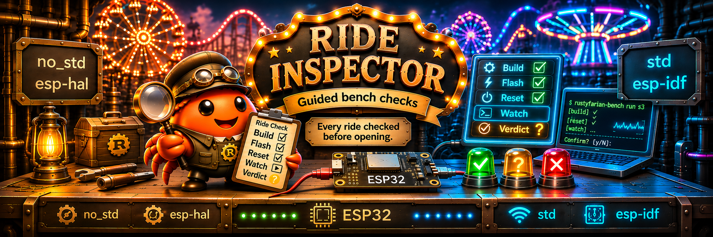

# rustyfarian-bench

<p align="center">
  
</p>

[](https://github.com/datenkollektiv/rustyfarian-bench/actions/workflows/verify.yml)
[](https://github.com/datenkollektiv/rustyfarian-bench/tags)
[](LICENSE-MIT)
[](pyproject.toml)
[](https://github.com/astral-sh/uv)
[](https://github.com/astral-sh/ruff)
[](https://mypy.readthedocs.io/)

Guided, rerunnable hardware bench tests for the rustyfarian ESP32 crates.

A consumer repo describes its boards and checks as TOML under `bench/`.
The runner builds the example, waits for the right board, flashes it, resets it, captures the serial output, and walks the operator through each step with an automatic verdict.

## Getting started

Prerequisites: [`just`](https://github.com/casey/just), [`uv`](https://docs.astral.sh/uv/), [`espflash`](https://github.com/esp-rs/espflash) and the consumer's Rust toolchain.
Python ≥ 3.12 is enough; `uvx` provisions it if missing.
Hardware runs are tested on macOS only; Linux serial ports are detected but untested on a bench, and Windows is unsupported.

Run a pinned release from a consumer repo, with no rustyfarian-bench checkout:

```sh
uvx --from git+https://github.com/datenkollektiv/rustyfarian-bench@v0.1.0 rustyfarian-bench --repo . list
uvx --from git+https://github.com/datenkollektiv/rustyfarian-bench@v0.1.0 rustyfarian-bench --repo . run s3
```

Pin the tag in the consumer's `bench` recipe; bumping it is how a consumer opts into a new release.

## Usage

From a consumer repo (e.g. `rustyfarian-peripherals`):

```sh
just bench hal_s3_b3f     # one example, then offers the scenario's next examples
just bench s3/rotary      # one check on one board
just bench s3             # every check for a board
just bench hal_s3_b3f --no-twins   # only the named example, not its twins
```

From this repo, against a sibling checkout:

```sh
just bench rustyfarian-peripherals s3 b3f   # <repo> <target> [flags]
just bench rustyfarian-ws2812 s3
just bench-list rustyfarian-ws2812
```

Directly:

```sh
uv run --project ../rustyfarian-bench rustyfarian-bench --repo . run hal_s3_b3f
uv run --project ../rustyfarian-bench rustyfarian-bench --repo . list
uv run --project ../rustyfarian-bench rustyfarian-bench detect
```

## Session flow

1. Build the example (`commands.build`, or the board's own `build`), so the slow part runs before the board is needed.
2. Poll serial ports and run `espflash board-info` on each until the board's chip (and optional MAC) answers; a port another session holds is skipped, so two boards can bench side by side (pin `mac` when two boards share a chip: the lock is only held while a session reads its port).
   `run --unique-board` refuses to guess instead: with two boards of the board's chip attached and no `mac` or `--port`, the run ends with an `error` naming both ports, and a busy or silent port blocks the decision until it resolves or `--detect-timeout` ends it.
   A board with `detect = false` (e.g. an AVR, which espflash cannot identify) never runs espflash; it is found by its USB identity when it declares `usb_id = "vid:pid"` (plus `usb_serial` to tell two identical bridges apart), else it needs `--port` (a lone attached port is no proof of which board it is), and the run stops without it.
   `run --detect-timeout SECONDS` ends the wait for a missing board with an `error` after that long (no probe starts after the limit, though a running probe may overrun it); without it the run waits for a plug-in.
3. Flash (`commands.flash`, or the board's own `flash`, with `{port}`).
4. Open the port exclusively, clearing RTS before DTR so the open itself does not reset an ESP (USB Serial/JTAG or the usual RTS/DTR auto-reset circuit); on a `reset = "dtr"` board the reader raises DTR only for its reset pulse, though the OS or driver may still toggle the lines while opening. Then reset into the app, and read it with pyserial, reopening across USB re-enumeration. The reset is an RTS pulse (esptool's USB-JTAG sequence) by default; `reset = "dtr"` pulses DTR for auto-reset bridges (Arduino Nano, CH340/FT232) and `"none"` skips the pulse but keeps the ESP-safe open, whose brief DTR high can still reset a DTR auto-reset board (use `"dtr"` for those); `baud` is per board. Every line is echoed and written to `bench/<board>/logs/<example>-<stamp>.log`.
5. Run the steps; each step waits for Enter and drops the backlog before its clock starts (`arm = false` for a step that must read what the reset printed, e.g. the banner); a failed step offers a retry, then asks what the operator saw and records it as the step's `note`.
   An `attended` watch (a `duration` step with `attended = true`) ends early when the operator presses Enter; it passes, and the detail records `ended by operator after N s of M s`; a `reject` seen before still fails it.
   Timed waits show a shrinking countdown on a terminal; an armed `duration` step's prompt shows its length, where Enter keeps it and a typed number of seconds changes it for this run (a longer one asks for confirmation) (the step detail records `(scenario: N s)`).
6. Offer the scenario's next example (e.g. the `idf` twin), then append the result to `bench/<board>/results.jsonl`; an example you asked for (everything but the twins of a named example) that you decline is recorded as `skipped`.

`--unattended` runs only the steps that need no person (no `confirm`, no `attended = true`) and implies `--yes`; `--attended` runs only the steps that need one.
A scenario with no step for the mode is not built, flashed or recorded, and a run with nothing left fails.
Each result records its `mode` (`"unattended"`, `"attended"` or `null`), so a pass in one mode is never read as a full pass.
To wrap up a release, run `just bench <board> --unattended` and walk away, then `just bench <board> --attended`; the release needs both to pass.

The runner never uses `espflash monitor` (without a TTY it leaves a USB-JTAG chip in the flash stub) or `espflash reset` (it enters the bootloader first and leaves a native-USB S3 in download mode).

## Consumer layout

```
bench/
├── bench.toml        commands + boards
└── s3/
    ├── b3f.toml      one scenario
    ├── logs/         captured output
    └── results.jsonl one JSON line per example run
```

`bench/bench.toml`:

```toml
[commands]
build = ["just", "build-example", "{example}"]
flash = ["just", "flash", "{example}", "{port}"]
image = ["just", "save-image", "{example}", "{image}"]   # optional: only `submit` runs it

[boards.s3]
chip = "esp32s3"
name = "CrowPanel 1.28\" HMI (ESP32-S3)"
# mac = "dc:54:75:..."   # pin one physical board
# checks = ["pulse", "rainbow"]   # run these first, in this order; the rest follow by name

[boards.avr]
chip = "atmega328p"
name = "Arduino Nano"
detect = false                                  # espflash cannot identify it
usb_id = "0403:6001"                            # found by USB identity instead (FTDI FT232R)
reset = "dtr"                                    # auto-reset bridge; default "rts", or "none"
# baud = 115200
build = ["just", "build-avr-bin", "{example}"]  # per-board commands override [commands]
flash = ["just", "flash-avr-bin", "{example}", "{port}"]
```

`image` is optional and consumer-owned, like `build` and `flash`.
It writes the flash image `submit` uploads (the whole flash from `0x0`: bootloader, partition table and app) to `{image}`; a board's own `image` overrides `[commands]`.
It may use `{example}` and `{image}`, and `run` never runs it.

A scenario:

```toml
examples = ["hal_s3_b3f", "idf_s3_b3f"]   # run in order; the shared steps apply to each

[[step]]
say = "Press the knob button 3 times"
expect = ['count=1\)', "released", 'count=2\)', "released", 'count=3\)', "released"]
reject = 'count=[4-9]'
settle = 2
```

## Step kinds

Each step has `say` and exactly one of:

| Key        | Passes when                                                               |
|:-----------|:--------------------------------------------------------------------------|
| `expect`   | the regexes match in order within `timeout` (default 30 s)                |
| `duration` | `reject` never matches and the serial link stays up for that many seconds |
| `confirm`  | the operator answers yes                                                  |

`probe` is a modifier on `expect` or `duration` that takes the lines from a host command instead of the serial port (see "Host probes").

Modifiers: `reject` (fails the step on match), `settle` (keep watching `reject` after the last `expect`), `optional` (a miss is a warning), `attended` (the step needs a person although it has no `confirm`, e.g. a PIR or a button press), `reset` (reset the board once the step starts, after Enter when armed, for a check the firmware runs at boot such as a calibration window; not on a `reset = "none"` board).
`expect` steps also see lines printed before the step started (e.g. the boot banner); `duration` steps only judge new lines.

A named group in an `expect` pattern captures the matched text for later steps of the same example: `(?P<pole>SOUTH|NORTH)`.
A later step's `expect` or `reject` refers to it as `(?P=pole)`, matched literally, so `(?!(?P=pole))(?:SOUTH|NORTH)` asks for the other pole.
Captures are recorded in the step's result; a reference whose step was skipped by the mode, or failed, fails the step at once.
A later step that defines the same name takes it over: what it does not capture is cleared, never kept from the earlier step.
Inside a character class, after `\`, or in a comment, `(?P=name)` is literal text, not a reference.

### Prompt placeholders

`say` and `confirm` may use `{port}`, `{example}`, `{board}`, `{chip}`, `{mac}` and earlier captures, so an attended step names the device to act on: `say = "Unplug {board} on {port} (MAC {mac})"`.
A prompt is guidance, not a verdict: a value that is missing renders as `{ip}?` and the step still runs.
The result records the names in `lacked`, and the runner warns once per step.
A literal brace is written `{{` or `}}`.
Captures do not cross a mode split, so an `--attended` run may show a marker for a capture made by an unattended step.
`StepResult.say` (and `say` in `results.jsonl`) is the rendered text, as shown on the terminal.

### Host probes

`probe = ["just", "mqtt-watch", "{example}"]` runs a host command and judges its stdout with the step's `expect`, `reject`, `settle` and `duration`, so a broker check needs no `confirm`.
The command is an argv list, with no shell.
stdout is matched.
stderr is only written to the log and echoed.
The command runs in the consumer directory, in its own process group.
At the end of the step the group gets SIGTERM, and SIGKILL after 2 s, so a `just` wrapper and its children go too.
The command's own log is `<example>-<stamp>.probe<N>.log` beside the serial log.
A command that exits before the step ends counts as a lost link, so `settle` and `duration` need a watcher that keeps running.
When a step fails, the detail adds `probe exited N` and the last stderr lines.
The tool must flush each line: `python -u`, `stdbuf -oL`.
Probe steps need no person unless `attended`: `--unattended` runs them and `--attended` skips them.
Serial lines are not judged during a probe step; a lost serial link is only warned about afterwards.
A retry starts the command again, so a probe must be a passive watcher.
A command that cannot start is an `error` result and ends the session, like a missing build tool.
Probes are POSIX only (macOS and Linux).
`serial_reject = 'PANIC|panicked'` (only with `probe`) judges the serial lines while the probe runs.
A match fails the step with `rejected serial line: '<line>'`, even after the probe matched.
Serial lines from before the step are drained first, and a match is seen within 0.2 s.
Without `serial_reject`, serial stays unjudged as above.
Its `(?P=name)` references are checked like `reject`.
`attended = true` is allowed on a probe step: `--attended` runs it, `--unattended` skips it.
That keeps a probe next to the attended action it observes, such as an unplug.
On an attended probe with `duration`, Enter ends the wait early.
A probe that subscribes to a broker sees the retained replay at subscribe time.
Make the pattern require a live message, e.g. match `retain=0`.
A probe and a `run` in the same step have no readiness handshake.
A non-retained message published before the subscriber is up can be missed.

```toml
[[step]]
say = "Watch the broker for status and two heartbeats"
probe = ["just", "mqtt-watch", "{example}"]
expect = ['status online', 'heartbeat \d+', 'heartbeat \d+']
reject = 'Connection refused'
timeout = 60
```

### Setup, teardown and run

A scenario can start and restore its host side, and a step can act on the host before it is judged.

```toml
examples = ["hal_c6_mqtt_lwt"]
setup = [["just", "mosquitto", "up"], ["just", "mqtt-pub", "bench-ping", "1"]]   # prove the broker accepts a connection; a retained-status read fails on a fresh broker
teardown = [["just", "mosquitto", "up"]]
hook_timeout = 60                    # per setup/teardown command, default 60

[[step]]
say = "T2: an inbound message reaches the firmware"
run = ["just", "mqtt-pub", "cmd", "hello"]
run_timeout = 10                     # default 30
expect = '\[app\] rx topic=\S+/cmd payload=hello retained=false'
```

The order per example is setup, build, detect, flash, steps, teardown.
Hooks run once per example.
An example the mode skips entirely runs no hooks.
A setup command that exits non-zero, times out or cannot start is an `error` with `setup failed: <summary>`.
Nothing is built or flashed then, and the rest of setup is skipped.
The session goes on with the next example.
Teardown always runs: after pass, fail, error, a failed setup and Ctrl-C.
A second Ctrl-C skips the rest of teardown and stops the session.
A failing teardown command is a warning; the verdict does not change.
`setup` may use `{example}` and `{board}`.
`teardown` may also use `{port}`, `{chip}` and `{mac}`.
If detection never happened, a teardown command that needs `{port}`, `{chip}` or `{mac}` is skipped and recorded as `not run: {port} unknown`.
`run` is an argv list on an `expect` or `duration` step, never on `confirm`.
It may use `{port}`, `{example}`, `{board}`, `{chip}`, `{mac}` and earlier captures.
Per attempt the order is: arm prompt, reset, probe starts, `run`, judging.
With a `probe`, the probe starts first so it can see what `run` causes.
A `run` plus `duration` step does not drain serial, so the board's reaction is judged.
A failing `run` fails the step with `run failed: <summary>` before judging.
A retry runs it again, and the evidence is the last attempt's.
`run_timeout` defaults to 30 s and needs `run`.
`hook_timeout` defaults to 60 s.
A `run` step needs no person unless it is `attended` or has `confirm`.
The `run` output is not captured for matching; use a `probe` for that.
A command that exits normally does not end its process group, so a daemon that `setup` starts survives.
A timeout and Ctrl-C end the group with SIGTERM, then SIGKILL after 2 s.
Each command is run in the consumer directory, without a shell, and POSIX only.

Each command is recorded as `argv`, `exit_code`, `duration`, `timed_out`, `error`, `stdout_tail`, `stderr_tail` and `log`.
The tails keep the last 5 lines, each cut to 200 characters.
The full output is in `<example>-<stamp>.setup<N>.log`, `.run<n>.log` and `.teardown<N>.log` beside the serial log.
`results.jsonl` gains `setup`, `teardown` (lists) and `steps[].run`; they are always present, and the old keys are unchanged.

The definition is checked strictly when it loads, before anything is built:
- Booleans and numbers must be real TOML values, so `optional = "false"` is an error rather than true.
- `timeout` and `duration` must be greater than 0, and `settle` must be 0 or more.
- Regexes must compile, and a `(?P=name)` reference needs an earlier step that captures `name`.
- Commands may use only `{example}`, plus `{port}` in `flash`.
- A `probe` must be a non-empty list of strings, and may use only `{port}`, `{example}`, `{board}`, `{chip}`, `{mac}` and names an earlier step captures; the reserved names win over a capture of the same name.
- A `probe` needs `expect` or `duration`, and cannot be combined with `confirm` or `reset`; `attended` is allowed.
- `serial_reject` needs `probe` and must compile.
- `run` must be a non-empty list of strings, needs `expect` or `duration`, and cannot be combined with `confirm`.
- `run_timeout` must be greater than 0 and needs `run`.
- `setup` and `teardown` must be lists of argv lists; `setup` may use only `{example}` and `{board}`, `teardown` also `{port}`, `{chip}` and `{mac}`.
- `say` and `confirm` are checked like `probe`: only the reserved names and earlier captures, and a stray brace is an error, as is a placeholder nested in a format spec; a literal brace is written `{{` or `}}`.
- `hook_timeout` must be greater than 0.
- A probe placeholder whose capture is missing at run time fails the step at once, before the command starts; so does `{mac}` when the board's MAC is unknown.
- `examples` must not be empty, and the names must not contain `/` or `..`.
- A board's `checks` must not list a name twice.

A lost serial link fails a `duration` or `settle` window.
The re-enumeration caused by the reset is ignored for `RESET_GRACE` (5 s; none with `reset = "none"`), so an unplug within the first 5 s after the reset goes unnoticed by watch windows.

## Verdicts and exit codes

| Verdict      | Meaning                                                                                          |
|:-------------|:-------------------------------------------------------------------------------------------------|
| `pass`       | every required step was observed and passed                                                      |
| `fail`       | a step failed, or the run stopped before the last step                                           |
| `unverified` | nothing failed, but a required `confirm` was skipped by `--yes`                                  |
| `error`      | the run broke (missing tool, no board within `--detect-timeout`, crash); the detail names the cause; a missing tool or board ends the session |
| `aborted`    | Ctrl-C; the session ends, later examples do not start                                            |
| `skipped`    | the operator declined a requested example; makes the run incomplete                              |

`run` exits 0 when every example passed and 3 when the only shortfall is `unverified` or skipped work.
It exits 1 on any fail, error or abort, 2 on a bench definition error, and 130 on Ctrl-C between examples.

## Remote bench

A shared host with the boards attached (e.g. a Raspberry Pi) runs checks for clients that see no USB, such as a devcontainer.
`submit` builds locally and uploads an image and the scenario; `serve` flashes, judges and stores the result.

On the host:

```sh
uv tool install 'rustyfarian-bench[serve] @ git+https://github.com/datenkollektiv/rustyfarian-bench'
rustyfarian-bench serve --host 0.0.0.0 --outbox /srv/bench/outbox
```

The host needs `espflash`, a uv-managed Python ≥ 3.12 and a user in the `dialout` group.
`serve` listens on `127.0.0.1:8000` by default; `--host 0.0.0.0` opens it to the network, and `--job-timeout` (default 600 s) ends a job that runs too long.
`--detect-timeout` (default 30 s) fails a job whose board is not attached in that time, so the worker is free for the next job.
Without the `serve` extra, `serve` prints the install hint and exits 2.
From a checkout, `just serve` runs it with the outbox in `tmp/outbox`, and `just submit <repo> <board> <example> --bench URL` sends a sibling repo's check to it.

From the client, in a consumer repo whose `bench.toml` has an `image` command:

```sh
rustyfarian-bench --repo . submit s3 hal_s3_b3f --bench http://pi.local:8000 --wait
```

`submit <board> <example> --bench URL` builds (`--no-build` skips it), runs the `image` command, uploads and prints the job id.
`--image PATH` uploads that file instead and skips both commands; `--check NAME` picks a check when several list the example.
Without `--wait`, `submit` returns at once and the job runs on; with it, `submit` polls the log once a second and exits like `run`.
Ctrl-C while waiting leaves the job running and exits 130; an unreachable host exits 2.

One worker runs the jobs of the whole host one at a time, in arrival order, so a probe can never touch a board mid-flash.
Each job runs the unchanged `run <example> --unattended --no-build --no-twins --detect-timeout N --unique-board` as a child process in a repo the server writes itself.
The board is found by chip detection, and a `mac` in the client's board table is carried and pinned in that repo.
An unpinned job refuses to guess between boards of the same chip, so with two attached it ends as `error` naming both ports; a silent stray port also blocks an unpinned job until `--detect-timeout`.
The `mac` must have the form `aa:bb:cc:dd:ee:ff`; `submit` rejects a malformed one before it builds, and `serve` answers 422.
The flash is `espflash write-bin` of the image at `0x0`, so nothing from the client's `bench.toml` runs on the host except the scenario's steps.

A scenario is refused, by `submit` before it builds and by `serve` again on arrival, when it has:
- `setup` or `teardown` commands;
- a `probe` or `run` on a step an unattended run reaches;
- a board with `detect = false`;
- no unattended step.

An attended-only step may keep its `probe` or `run`: it is not run remotely.
The remote run is unattended, so a verdict from it is never a full pass; the attended steps still need `--attended` on the bench.

Every job is kept in `outbox/<id>/`, the id being `YYYYmmdd-HHMMSS-<hex>` in UTC:

```
outbox/20261112-093000-a1b2c3/
├── job.json       status, board, example, verdict, detail, exit code
├── image.bin      the uploaded image
├── scenario.toml  the uploaded scenario
├── bench/         the repo the child ran in, with logs/ and results.jsonl
├── run.log        the child's output
└── result.json    verdict, detail, exit code and the result rows
```

`GET /jobs/<id>?offset=N` returns the job and the log from byte `N`; `POST /jobs` takes a JSON body with the scenario and the base64 image.
`submit --wait` exits 0 on `pass`, 3 on `unverified` or `incomplete`, and 1 on anything else, as `run` does.
A job keeps the recorded verdict only when `run`'s exit code agrees with it; otherwise it is `error`.
A job a restart interrupted ends as `error`; killing `serve` with SIGKILL can leave a running child flashing.

There is no authentication or TLS, so anyone who reaches the port can flash a board and read every job.
An image can hold Wi-Fi credentials and `outbox/` is kept forever, so run `serve` only on a trusted network and clear the outbox yourself.

## Development

```sh
just verify               # ruff, format check, mypy --strict, pytest
just verify-python 3.12   # the same gate on the declared Python floor
just smoke-install        # build the wheel and run it through an isolated uvx
```
