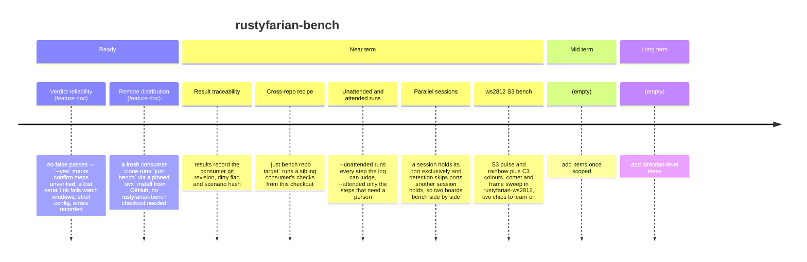

# Roadmap — rustyfarian-bench

Last updated: November 2026

Guided, rerunnable hardware bench tests for the rustyfarian ESP32 crates.
Items flow Long term → Mid term → Near term → Ready → done; Ready items have a feature doc in `docs/features/`.

